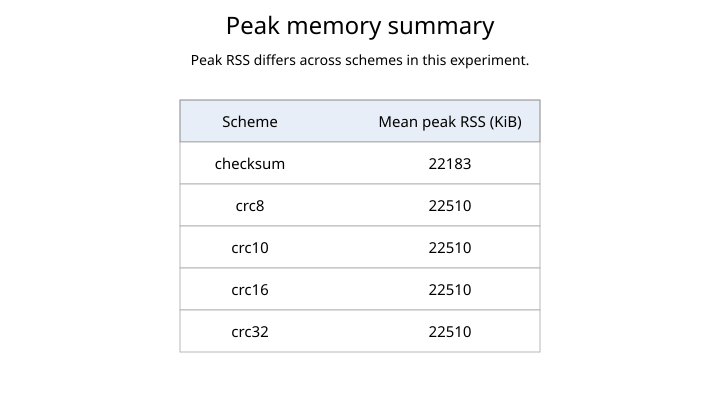

# Checksum and CRC Error-Detection Simulation

## 1. Objective

The project compares a 16-bit one's-complement checksum with CRC-8, CRC-10,
CRC-16, and CRC-32 while transferring a binary file between separate sender
and receiver processes. It measures whether injected errors are detected,
receiver execution time, CPU time, and maximum resident-set size.

## 2. Implementation

The implementation is pure C17 and uses POSIX TCP sockets. TCP was selected so
transport loss and reordering do not confound the error-detection experiment.
The sender deliberately corrupts bytes after computing the frame FCS; the TCP
record prefix itself is not corrupted.

### 2.1 Simulated frame

The fixed 15-byte header is serialized field-by-field:

| Field | Bytes | Encoding |
| --- | ---: | --- |
| Source MAC | 6 | Raw bytes |
| Destination MAC | 6 | Raw bytes |
| Actual payload length | 2 | Unsigned, network byte order |
| Sequence number | 1 | Unsigned byte |

The actual payload is zero-padded to at least 48 bytes. The maximum common
payload is 1499 bytes, leaving room for the largest four-byte FCS within the
1518-byte frame maximum. The FCS covers the serialized header and complete
padded payload, but not the FCS field itself.

CRC-10 uses a two-byte network-order FCS. Its ten remainder bits are
left-aligned and its low six bits are zero. The receiver rejects nonzero
padding bits before shifting the remainder right for verification.

### 2.2 Error-detection algorithms

The checksum treats adjacent input bytes as network-order 16-bit words, folds
end-around carries, and complements the final sum. An odd final byte occupies
the high half of its word.

All CRC variants use generic MSB-first polynomial division with these
parameters:

| Scheme | Width | Lower polynomial |
| --- | ---: | ---: |
| CRC-8 | 8 | `0xD5` |
| CRC-10 | 10 | `0x233` |
| CRC-16 | 16 | `0x8005` |
| CRC-32 | 32 | `0x04C11DB7` |

The initial remainder is zero, there is no reflection, and there is no final
XOR. Width masking is safe for the complete supported range of 1--32 bits.

### 2.3 Error patterns

The sender supports the following seeded patterns:

- one randomly positioned flipped bit;
- two distinct nonadjacent flipped bits;
- three distinct flipped bits;
- a contiguous 16-bit burst; and
- a per-frame random choice among those four patterns.

The fixed generator recurrence is
`state = state * 1664525 + 1013904223` using defined `uint32_t` wraparound.
Every injection operation validates its complete request before modifying data,
so rejected operations preserve both bytes and generator state.

## 3. Receiver behavior and metrics

TCP records use an external two-byte length followed by one complete simulated
frame. A zero length ends the transfer. After reading a record, the receiver:

1. parses and validates the header;
2. derives the padded payload and expected complete frame sizes;
3. parses the selected network-order FCS;
4. verifies the checksum or CRC; and
5. writes only the actual unpadded payload of accepted frames.

CSV output records received, accepted, and rejected counts; rejection rate;
payload bytes written; monotonic elapsed time; user and system CPU time; and
maximum resident-set size.

## 4. Verification

The automated C suite covers normal, boundary, malformed, and atomic-rejection
behavior for checksum, CRC, error injection, frame handling, and exact-length
socket I/O. Frame tests pin every FCS wire representation, CRC-10 padding,
network byte order, minimum padding, maximum payload length, corruption
rejection, and output preservation on invalid input.

The end-to-end control transfers the deterministic 4096-byte binary fixture in
three frames for every scheme and compares the received file byte-for-byte.

## 5. Experiment results

The quick checked-in CSV is useful for checking the workflow, but it is too
small for a report-quality comparison. The `experiments_inference` target uses
a 1 MiB deterministic fixture for injected-error trials and an 8 MiB fixture
for no-error timing controls. With its default repeat counts, each
scheme/pattern detection result contains about 14,000 corrupted frames, while
the timing controls contain about 56,000 frames per scheme.

No-error controls are evaluated separately from injected-error runs: they
establish lossless transfer behavior, whereas error runs establish observed
detection behavior.

The error figure reports *undetected* frame rate rather than detection rate.
This makes the useful comparison visible: a 100% detection rate becomes 0%
undetected, and any observed miss is shown explicitly. A 0% cell means that no
miss was observed in this experiment; it is not a claim that a miss is
theoretically impossible.


The timing figure uses only no-error controls, so its bars compare the
implementation cost of each FCS scheme rather than differences caused by
rejected frames. Whiskers show one standard deviation across runs. The values
are receiver elapsed times for a small loopback transfer, not end-to-end
network latency.


Peak resident-set size is presented as a summary table rather than a bar chart.
When every scheme has the same value, a bar chart would falsely imply a useful
performance distinction.



## 6. Interpretation and limitations

The present experiment demonstrates observed behavior for the selected seeds;
it does not estimate a general undetected-error probability. A final comparison
should use a substantially larger input and more seeds, retain the same input
for every scheme, and report both the number of corrupted frames and the number
rejected. Timing should also use larger inputs so scheduling noise is small
relative to algorithm execution.

The current bitwise CRC implementation intentionally favors a transparent
academic model over lookup-table optimization. Its timing therefore compares
these implementations, not the best achievable performance of each CRC.

## 7. Reproduction

From the repository root:

```bash
make -C C test
make -C C test_end_to_end
make -C C experiments_inference
make -C C plots
```

Python utilities are executed by uv using `C/pyproject.toml` and `C/uv.lock`.
The deterministic input fixtures can be regenerated with
`make -C C generate_test_data`.
