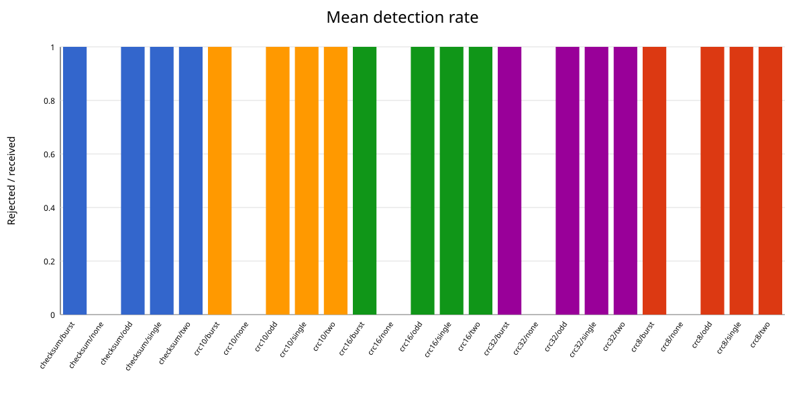
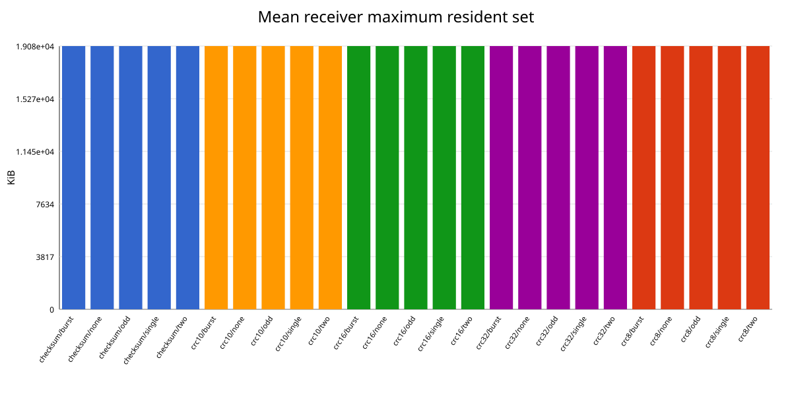

# Checksum and CRC Error-Detection Simulation

## 1. Objective

The project compares a 16-bit one's-complement checksum with CRC-8, CRC-10,
CRC-16, and CRC-32 while transferring a binary file between separate sender
and receiver processes. It measures whether injected errors are detected,
receiver execution time, CPU time, and maximum resident-set size.

## 2. Implementation

The implementation is pure C17 and uses POSIX TCP sockets. TCP was selected so
transport loss and reordering do not confound the error-detection experiment.
The sender deliberately corrupts bytes after computing the frame FCS; the TCP
record prefix itself is not corrupted.

### 2.1 Simulated frame

The fixed 15-byte header is serialized field-by-field:

| Field | Bytes | Encoding |
| --- | ---: | --- |
| Source MAC | 6 | Raw bytes |
| Destination MAC | 6 | Raw bytes |
| Actual payload length | 2 | Unsigned, network byte order |
| Sequence number | 1 | Unsigned byte |

The actual payload is zero-padded to at least 48 bytes. The maximum common
payload is 1499 bytes, leaving room for the largest four-byte FCS within the
1518-byte frame maximum. The FCS covers the serialized header and complete
padded payload, but not the FCS field itself.

CRC-10 uses a two-byte network-order FCS. Its ten remainder bits are
left-aligned and its low six bits are zero. The receiver rejects nonzero
padding bits before shifting the remainder right for verification.

### 2.2 Error-detection algorithms

The checksum treats adjacent input bytes as network-order 16-bit words, folds
end-around carries, and complements the final sum. An odd final byte occupies
the high half of its word.

All CRC variants use generic MSB-first polynomial division with these
parameters:

| Scheme | Width | Lower polynomial |
| --- | ---: | ---: |
| CRC-8 | 8 | `0xD5` |
| CRC-10 | 10 | `0x233` |
| CRC-16 | 16 | `0x8005` |
| CRC-32 | 32 | `0x04C11DB7` |

The initial remainder is zero, there is no reflection, and there is no final
XOR. Width masking is safe for the complete supported range of 1--32 bits.

### 2.3 Error patterns

The sender supports the following seeded patterns:

- one randomly positioned flipped bit;
- two distinct nonadjacent flipped bits;
- three distinct flipped bits;
- a contiguous 16-bit burst; and
- a per-frame random choice among those four patterns.

The fixed generator recurrence is
`state = state * 1664525 + 1013904223` using defined `uint32_t` wraparound.
Every injection operation validates its complete request before modifying data,
so rejected operations preserve both bytes and generator state.

## 3. Receiver behavior and metrics

TCP records use an external two-byte length followed by one complete simulated
frame. A zero length ends the transfer. After reading a record, the receiver:

1. parses and validates the header;
2. derives the padded payload and expected complete frame sizes;
3. parses the selected network-order FCS;
4. verifies the checksum or CRC; and
5. writes only the actual unpadded payload of accepted frames.

CSV output records received, accepted, and rejected counts; rejection rate;
payload bytes written; monotonic elapsed time; user and system CPU time; and
maximum resident-set size.

## 4. Verification

The automated C suite covers normal, boundary, malformed, and atomic-rejection
behavior for checksum, CRC, error injection, frame handling, and exact-length
socket I/O. Frame tests pin every FCS wire representation, CRC-10 padding,
network byte order, minimum padding, maximum payload length, corruption
rejection, and output preservation on invalid input.

The end-to-end control transfers the deterministic 4096-byte binary fixture in
three frames for every scheme and compares the received file byte-for-byte.

## 5. Pilot experiment

The checked-in CSV contains three repeats for all five schemes and five error
conditions using seeds `0x12345678` through `0x1234567A`. Each run transferred
the 4096-byte deterministic fixture as three frames.

| Scheme | Mean injected-error detection | Mean no-error receiver time (s) |
| --- | ---: | ---: |
| Checksum-16 | 1.000 | 0.000071 |
| CRC-8 | 1.000 | 0.000490 |
| CRC-10 | 1.000 | 0.000499 |
| CRC-16 | 1.000 | 0.000542 |
| CRC-32 | 1.000 | 0.000614 |

All no-error controls accepted three frames and reproduced all 4096 bytes. In
this small seeded pilot, every deliberately corrupted frame was rejected. The
checksum was faster because it processes 16-bit words, while the academic CRC
implementation performs bitwise polynomial division. Maximum resident-set
measurements were identical at 19084 KiB in this environment and therefore do
not distinguish the algorithms.






## 6. Interpretation and limitations

The pilot confirms implementation behavior, but nine corrupted frames per
scheme/pattern are too few for a defensible estimate of rare undetected-error
rates. A final comparison should use a substantially larger input and more
seeds, retain the same input for every scheme, and report both the number of
corrupted frames and the number rejected. Timing should also use larger inputs
so startup and scheduling noise are small relative to algorithm execution.

The current bitwise CRC implementation intentionally favors a transparent
academic model over lookup-table optimization. Its timing therefore compares
these implementations, not the best achievable performance of each CRC.

## 7. Reproduction

From the repository root:

```bash
make -C C test
make -C C test_end_to_end
make -C C experiments EXPERIMENT_REPEATS=3
make -C C plots
```

Python utilities are executed by uv using `C/pyproject.toml` and `C/uv.lock`.
The deterministic input fixtures can be regenerated with
`make -C C generate_test_data`.
