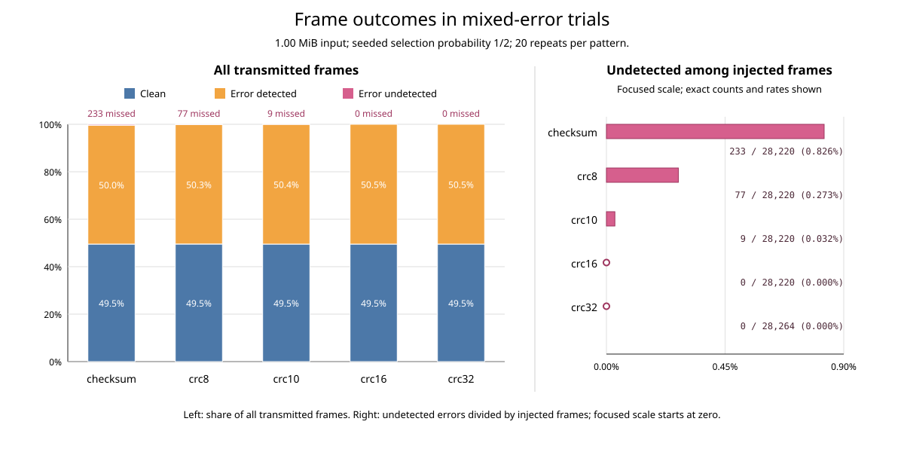
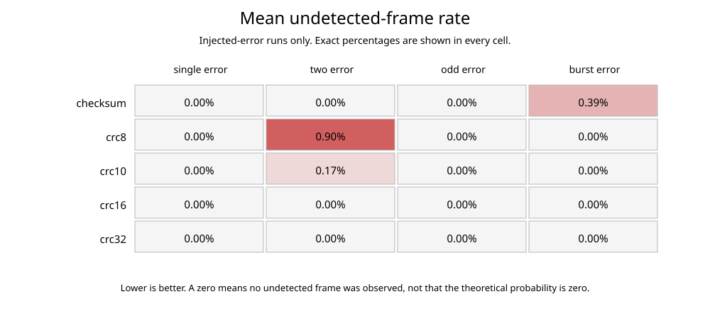
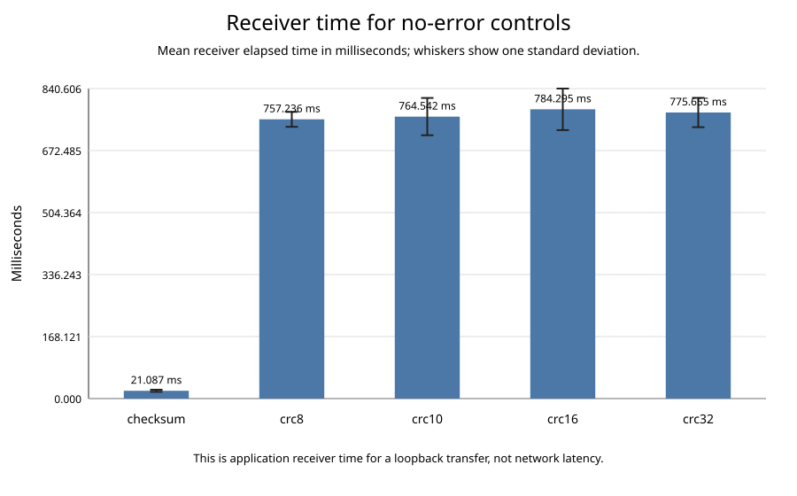
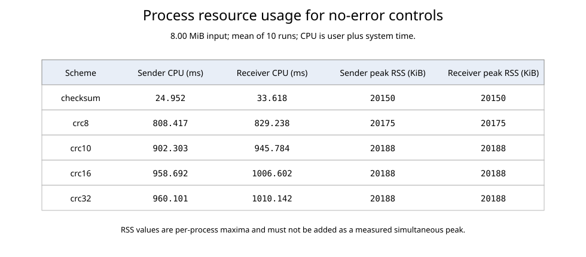

<!--
Generated file; do not edit directly.
Generator: C/tools/generate_report.py
Template: C/report/report_template.md
Source CSV: `results/experiments_mixed.csv`
Regenerate: make -C C report
-->

# Checksum and CRC Error-Detection Simulation

Course: **CSE/PC/B/S/314 Computer Networks Lab**, CO1, Assignment 1.

This is a generated technical working report. The PDF's separate
report-preparation instructions are unavailable, as confirmed by the user;
final formatting, demonstration, submission, and Drive upload remain pending.
The section structure below is a project choice, not an instructor-issued
format. See [the requirements audit](../../docs/assignment-compliance.md).

The user confirmed the illustration's **64--1518-byte complete-frame range**
and explicitly requires **sequence numbers**, despite their omission from the
PDF. Current test success does not certify complete assignment conformance:
CRC-32 still permits a 45-byte padded payload against the PDF's 46-byte minimum;
header-length semantics and arbitrary polynomial CLI input remain unresolved.

## 1. Technical summary

The implementation transfers deterministic text fixtures over TCP in simulated
Ethernet-sized frames protected by a 16-bit one's-complement checksum or one of
four CRCs. It tests single-bit, two-bit, odd three-bit, and 16-bit burst errors,
then uses separate clean controls for timing and resource comparisons.

The validated campaign contains **450 runs**. Each scheme and injected pattern uses 20 repeats of the 1.00 MiB detection input. Each scheme also uses 10 clean repeats of the 8.00 MiB performance input. For injected runs, each frame is selected reproducibly with probability 1/2; the recorded clean and injected counts are observed outcomes, not assumed quotas.

Observed undetected frames were Checksum two-bit: 164 of 7,055; Checksum odd three-bit: 38 of 7,055; Checksum 16-bit burst: 31 of 7,055; CRC-8 two-bit: 77 of 7,055; CRC-10 two-bit: 9 of 7,055.

The empirical results are evidence for this input and these reproducible seeds;
they do not replace the mathematical guarantees of each code. Timing is measured
between two processes on one loopback host, so it compares these implementations
rather than physical-network latency or optimized production CRCs.

## 2. Scope and experiment files

Files intended for transmission remain separate from received files:

- `C/input_files/detection_1m.txt` is exactly 1,048,576 bytes;
- `C/input_files/performance_8m.txt` is exactly 8,388,608 bytes; and
- `C/output_files/` receives the latest output for each experiment combination.

Both inputs are deterministic, human-readable ASCII text generated by
`C/tools/generate_test_data.py`. The complete per-run evidence is stored in
`C/results/experiments_mixed.csv`. Tables in this report and all SVG figures are
regenerated from that CSV after its schema and frame-count invariants pass.

## 3. Implementation

The C17 sender and receiver use POSIX TCP sockets. TCP prevents transport loss
and reordering from being confused with the deliberate corruption under test.
The sender calculates a frame's FCS first, then corrupts selected bytes; the
external TCP record-length prefix is never corrupted.

### 3.1 Simulated frame

The fixed 15-byte header is serialized field by field:

| Field | Bytes | Encoding |
| --- | ---: | --- |
| Source MAC | 6 | Raw bytes |
| Destination MAC | 6 | Raw bytes |
| Actual payload length | 2 | Unsigned, network byte order |
| Sequence number | 1 | Unsigned byte |

Sequence numbering is a project requirement supported by the illustration and
the user's clarification. The sender starts at zero for each transfer and
increments modulo 256, giving `0, ..., 254, 255, 0, ...`. The receiver parses
the field, and the FCS protects it along with the rest of the header. Live
audit captures verified wrap for all five schemes, and individual sequence-bit
flips were rejected for each scheme.

TCP maintains record order. There is no separate receiver expected-sequence
state machine, acknowledgement, retransmission, or ARQ implementation. Rejected
frames leave gaps, and later valid records are still accepted. A one-byte
sequence value is a modulo identifier, not a globally unique frame number.

Payload padding and maximum chunks depend on FCS size. CRC-8 uses 48--1502
transmitted payload bytes; the two-byte schemes use 47--1501 bytes; CRC-32 uses
45--1499 bytes. This keeps every complete frame within 64--1518 bytes. The FCS
covers the serialized header and complete padded payload, excluding the FCS
field itself.

The 64--1518-byte range follows the illustration as confirmed by the user. The
PDF's separate 46-byte minimum padded payload is still an open code gap:
15 header + 45 payload + 4 CRC-32 = 64 bytes currently, whereas 46 padded bytes
would yield 65. The header's length field records valid unpadded payload bytes
to preserve legitimate trailing zeroes; the illustration labels this “Length
of Frame”. Its exact required meaning needs clarification. The external TCP
record length does not replace that header field. This is a custom
Ethernet-sized simulation, not a complete IEEE 802.3 frame implementation.

CRC-10 uses a two-byte network-order field. Its ten remainder bits are
left-aligned and its low six bits are zero; the receiver rejects nonzero padding
bits before verification.

### 3.2 Error-detection algorithms

The checksum sums adjacent bytes as network-order 16-bit words, repeatedly folds
end-around carries, and complements the result. An odd trailing byte occupies
the high half of its word.

All CRC variants use generic MSB-first polynomial division with an initial
remainder of zero, no reflection, and no final XOR:

| Scheme | Width | Lower polynomial | Guaranteed properties relevant here |
| --- | ---: | ---: | --- |
| CRC-8 | 8 | `0xD5` | All single-bit and odd-weight errors; all bursts of at most 8 bits |
| CRC-10 | 10 | `0x233` | All single-bit and odd-weight errors; all bursts of at most 10 bits |
| CRC-16 | 16 | `0x8005` | All single-bit and odd-weight errors; all bursts of at most 16 bits |
| CRC-32 | 32 | `0x04C11DB7` | All single-bit errors; all bursts of at most 32 bits |

The odd-weight guarantee follows from the factor `(x + 1)`, which is present in
the CRC-8, CRC-10, and CRC-16 generator polynomials but not CRC-32. For this
frame-size range, CRC-8 and CRC-10 can miss some two-bit separations, while the
chosen CRC-16 and CRC-32 polynomials detect every two-bit separation that fits
in a maximum-sized simulated frame. The relevant two-bit recurrence orders are
93 for CRC-8, 511 for CRC-10, and 32,767 for CRC-16; CRC-32's order also exceeds
the 12,144-bit maximum frame. These statements describe the exact polynomials
and non-reflected convention implemented here.

The four lower polynomials match the PDF. The CLI accepts their scheme names
as selectors; the C API accepts a width/polynomial parameter object. Arbitrary
polynomial coefficients are not accepted as CLI input. The listed Bluetooth,
USB, and Ethernet usage domains in the PDF do not specify full CRC parameter
profiles, so this report does not claim bit-for-bit interoperability with them.

### 3.3 Seeded mixed-frame selection

Injected-pattern runs independently select each frame with probability
`1 / ERROR_INTERVAL`; the default denominator is two. Selection uses a dedicated
seeded generator, while a separate generator chooses error positions. This
separation means changing the number of selection draws cannot silently shift
the bit-position sequence. `ERROR_INTERVAL=1` selects every frame without
advancing the selection generator.

Both generators use the fixed recurrence
`state = state * 1664525 + 1013904223` with defined `uint32_t` wraparound. Every
injection function validates the complete operation before changing data, so a
rejected request preserves the bytes and generator state.

Random bit positions and mixed-pattern choices use multiply-high bounded
sampling with rejection of the small incomplete bucket. This avoids the LCG's
weak low bits and modulo bias. Two-bit pairs are resampled until nonadjacent;
odd-bit subsets use Floyd sampling so positions remain distinct without
unbounded duplicate searches. Random buffers are limited to 2^32 addressable
bits (and the platform's `size_t` limit). These revised position sequences
supersede the earlier low-bit-modulo campaign.

## 4. Receiver behavior and metric definitions

Each TCP record is a two-byte length followed by one complete simulated frame;
a zero length terminates the transfer. The receiver validates the record and
writes only the actual unpadded payload of accepted frames. Rejected frames are
not written, so an injected run normally produces a shorter output.

The CSV categories satisfy these identities for every run:

- `frames_sent = frames_clean + frames_injected`;
- `frames_received = frames_accepted + frames_rejected`;
- `undetected_frames = frames_injected - frames_rejected`; and
- `frames_accepted = frames_clean + undetected_frames`.

Detection rate is `frames_rejected / frames_injected`. Clean frames are excluded
from that denominator. For a `none` control, both detection rates are zero by
definition and the output must match the input byte for byte.

Accepted does not mean guaranteed error-free: an injected codeword can pass
verification and carry undetected corruption, as the illustration emphasizes.
Receiver rejection counts also include malformed length/padding and CRC-10
padding checks; they are not a separate tally of nonzero algebraic syndromes.

Elapsed time uses `CLOCK_MONOTONIC`. User and system CPU time come from
`getrusage(RUSAGE_SELF)`. Peak RSS is Linux `/proc/self/status`'s `VmHWM`,
measured inside each executable after transfer. This excludes the Python
launcher's pre-exec address space, which contaminated the earlier `ru_maxrss`
figures. The programs require readable Linux procfs for this metric. RSS is a
separate per-process maximum and is not summed as though the peaks were
simultaneous.

## 5. Evaluation results

### 5.1 Aggregate frame outcomes

The following table pools the four injected patterns and all repeats. Because
selection is random, clean and injected counts are observed totals rather than
fixed half-frame quotas.

| Scheme | Clean | Injected | Detected | Undetected | Detection rate |
| --- | ---: | ---: | ---: | ---: | ---: |
| Checksum | 27,700 | 28,220 | 27,987 | 233 | 99.1743% |
| CRC-8 | 27,700 | 28,220 | 28,143 | 77 | 99.7271% |
| CRC-10 | 27,700 | 28,220 | 28,211 | 9 | 99.9681% |
| CRC-16 | 27,700 | 28,220 | 28,220 | 0 | 100.0000% |
| CRC-32 | 27,736 | 28,264 | 28,264 | 0 | 100.0000% |



### 5.2 Results by injected pattern

Each cell shows `undetected / injected (undetected rate)`. A zero means that this
campaign observed no miss, not that the theoretical miss probability is zero.

| Scheme | single-bit | two-bit | odd three-bit | 16-bit burst |
| --- | ---: | ---: | ---: | ---: |
| Checksum | 0 / 7,055 (0.0000%) | 164 / 7,055 (2.3246%) | 38 / 7,055 (0.5386%) | 31 / 7,055 (0.4394%) |
| CRC-8 | 0 / 7,055 (0.0000%) | 77 / 7,055 (1.0914%) | 0 / 7,055 (0.0000%) | 0 / 7,055 (0.0000%) |
| CRC-10 | 0 / 7,055 (0.0000%) | 9 / 7,055 (0.1276%) | 0 / 7,055 (0.0000%) | 0 / 7,055 (0.0000%) |
| CRC-16 | 0 / 7,055 (0.0000%) | 0 / 7,055 (0.0000%) | 0 / 7,055 (0.0000%) | 0 / 7,055 (0.0000%) |
| CRC-32 | 0 / 7,066 (0.0000%) | 0 / 7,066 (0.0000%) | 0 / 7,066 (0.0000%) | 0 / 7,066 (0.0000%) |



### 5.3 Assignment-required comparison cases

The required cases are made explicit below. The aggregate comparisons use the
same fixture, repeats, selection denominator, and seeds for checksum and the
named CRC. The CSV retains marginal detection totals, so `Case count bounds`
gives the minimum and maximum possible number of paired trials with the stated
outcome. A single number means the marginals determine the intersection
exactly. A range starting at zero does not establish that outcome occurred in
this campaign. A checksum-only count cannot be obtained by simply subtracting
CRC detections when checksum also misses some errors.

| Required case | Pattern | CRC | Trials | Checksum detected | CRC detected | Case count bounds |
| --- | --- | --- | ---: | ---: | ---: | ---: |
| Both detect | single | CRC-16 | 7,055 | 7,055 | 7,055 | 7,055 |
| Checksum only | two | CRC-10 | 7,055 | 6,891 | 7,046 | 0--9 |
| CRC only | burst | CRC-16 | 7,055 | 7,024 | 7,055 | 31 |

In addition, `tests/test_evaluation.c` pins one deterministic byte-level fixture
for each case: both checksum and CRC-16 detect a single-bit flip; checksum
detects a two-bit error that CRC-10 misses; and CRC-16 detects a compensating
two-bit change that leaves the checksum unchanged. This directly proves that
all three categories are represented independently of campaign sampling.

| Direct case | Original data | Controlled mutation | Verified outcome |
| --- | --- | --- | --- |
| Both detect | `12 34` | Flip bit 0, producing `92 34` | Checksum and CRC-16 reject |
| Checksum only | 256 zero bytes | Flip bits 0 and 511 | Checksum rejects; CRC-10 accepts |
| CRC only | `00 00 00 01` | Flip bits 15 and 31, producing `00 01 00 00` | Checksum accepts; CRC-16 rejects |

Bit indices are zero-based, MSB-first. These are paired reusable-algorithm
fixtures, not extra socket campaign rows. They use identical source bytes and
identical bit flips for the two algorithms being compared.

### 5.4 Clean-control execution time

Only the 8 MiB `none` controls are used for timing, avoiding comparisons between
runs that wrote all payloads and runs that rejected corrupted frames.

| Scheme | Sender mean (ms) | Receiver mean (ms) | Receiver SD (ms) |
| --- | ---: | ---: | ---: |
| Checksum | 29.874 | 35.128 | 11.176 |
| CRC-8 | 799.108 | 821.727 | 211.098 |
| CRC-10 | 753.935 | 760.542 | 64.761 |
| CRC-16 | 768.573 | 775.071 | 76.618 |
| CRC-32 | 818.926 | 829.762 | 144.367 |



### 5.5 Clean-control process resources

CPU time and peak RSS are reported separately for sender and receiver.

| Scheme | Sender CPU (ms) | Receiver CPU (ms) | Sender peak RSS (KiB) | Receiver peak RSS (KiB) |
| --- | ---: | ---: | ---: | ---: |
| Checksum | 29.499 | 34.108 | 2270 | 2282 |
| CRC-8 | 794.615 | 812.064 | 2267 | 2283 |
| CRC-10 | 750.568 | 749.229 | 2268 | 2284 |
| CRC-16 | 765.144 | 766.288 | 2271 | 2282 |
| CRC-32 | 815.027 | 820.175 | 2270 | 2282 |



## 6. Verification and reproducibility

Experiment batches stage and validate their CSV before replacing the previous
result, including both inputs of the full campaign. Failed transfers preserve
the previous CSV and stop/reap the receiver. Append continues repeat identities
and base-seed offsets, rejecting changes to group input paths, byte counts, or
error denominators. Aggregation checks that metadata in every repeat. Inputs
must be retained: same-path, same-size edits are not detected.

The subsequent review fixes preserved this recorded 450-row campaign and the
existing frame geometry. The minimum-payload issue (review problem 6) was
explicitly excluded by the user and remains open.

The C tests cover checksum, all CRCs, error injection, frame serialization,
socket helpers, and the three required evaluation comparisons. End-to-end
`none` runs compare output to input byte for byte for every scheme. The mixed
smoke test checks all four frame-count identities above.

From the repository root, regenerate and verify the deliverables with:

```bash
make -C C test
make -C C test_end_to_end
make -C C test_mixed_end_to_end
make -C C experiments_inference
make -C C results
```

`make -C C results` regenerates both the plots and this report from
`C/results/experiments_mixed.csv`. To update only the Markdown report, use
`make -C C report`. Edit `C/report/report_template.md`, never the generated
`C/report/report.md`.

## 7. Limitations

Finite empirical trials cannot prove a zero miss probability. The deterministic
fixtures and seeds make this campaign reproducible, but other input corpora and
seeds may expose additional rare misses.

The timing experiment runs two processes on one loopback host. It includes
serialization, FCS calculation, verification, socket copying, and file I/O in
this environment; it does not measure wide-area latency or physical-network
loss. The transparent bitwise CRC implementation prioritizes auditability over
lookup-table performance, so the resource comparison applies to these
implementations rather than each algorithm's best possible optimization.

The campaign samples odd errors of weight three and all-one contiguous bursts
of length 16; it does not exhaust every odd weight, burst shape, or burst
length. The CLI's mixed `random` mode is tested separately and is not a sixth
pattern in the 450-row campaign. Sequence continuity/ARQ and arbitrary
polynomial CLI parsing are not implemented. The unresolved payload minimum and
header-length interpretation are listed in the requirements audit.

## 8. Conclusion

The implementation demonstrates file transfer over sockets, seeded error
injection, checksum and all four CRC variants, and the three required detection
cases. The campaign tables show the actual misses for this data and seed set;
the deterministic fixtures establish cases that marginal campaign counts alone
cannot establish. CRC-16 and CRC-32 had no observed misses in this campaign;
that observation does not establish universal zero-miss behavior. Timing and
memory conclusions apply to these implementations on this loopback host.

Sequence numbering remains part of the project design and has been checked
across wrap and single-bit corruption. Full assignment compliance remains
pending the explicit minimum-payload issue and interpretation decisions. Final
report formatting and submission must be verified separately.

## 9. Assignment sources and submission status

- [Assignment PDF](<../../ErrorDetection(Checksum and CRC).pdf>): course,
  objective, checksum/CRC catalogue, required errors and comparisons, tables,
  graphs, execution time, resources, and the reference to report-format rules.
- [Protocol illustration](../../instruction.jpg): sockets, frame layout,
  zero padding, FCS sizes, header fields, sequence byte, and complete-frame
  bounds. It is a protocol diagram, not the missing report-format guide.
- [Requirement audit](../../docs/assignment-compliance.md): source-to-code
  traceability, user-confirmed clarifications, current evidence, and open gaps.

The PDF records demonstration dates of August 10--14, 2026 and report dates of
August 17--21, 2026, plus a Drive softcopy requirement. These source dates are
retained without implying completion, rescheduling, or an upload. No separate
formatting rules are available, as confirmed by the user on November 13, 2026;
cover details, page format, and final delivery remain pending rather than
being invented as instructor requirements.
